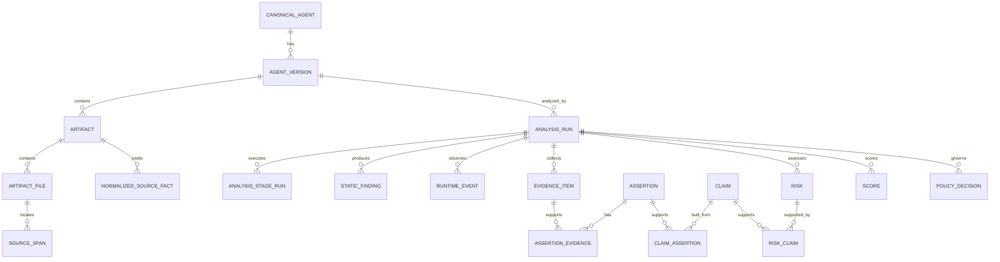
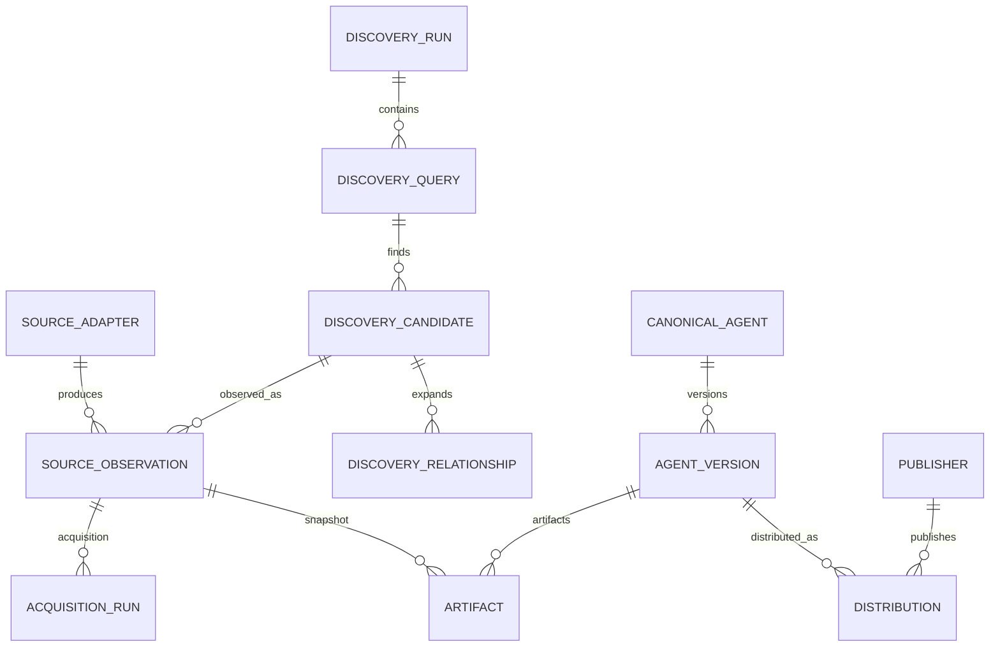
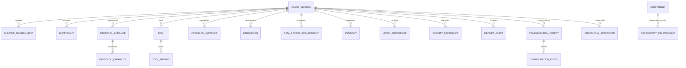
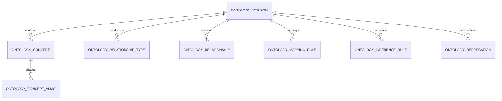
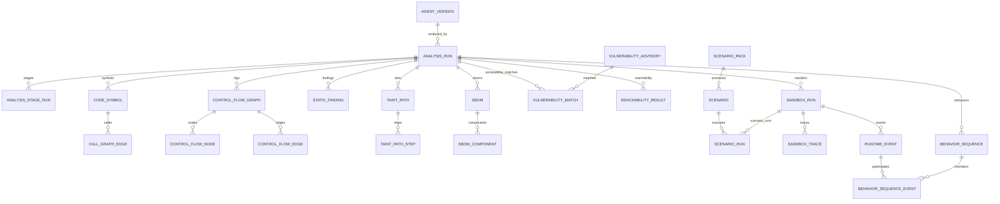
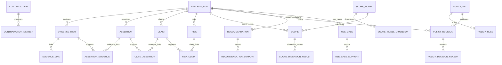
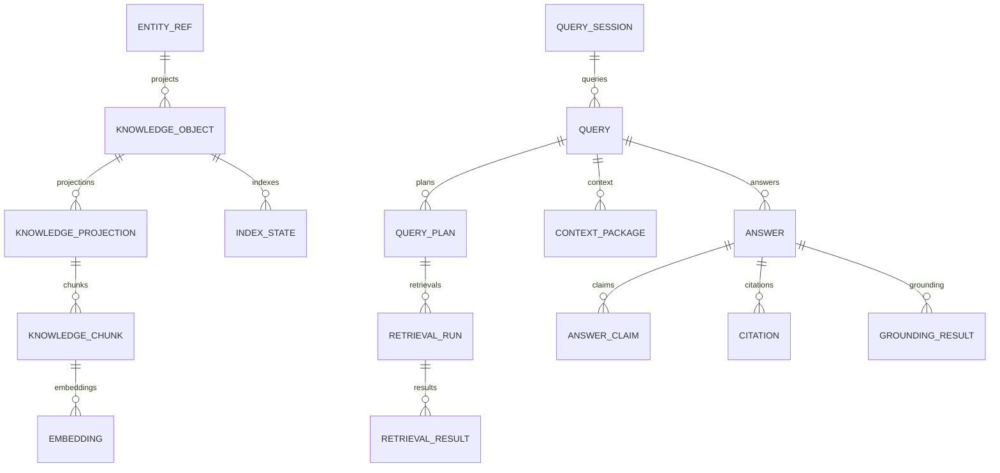
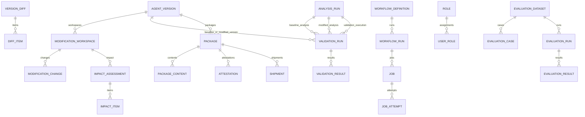
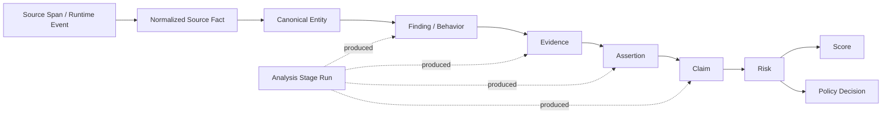
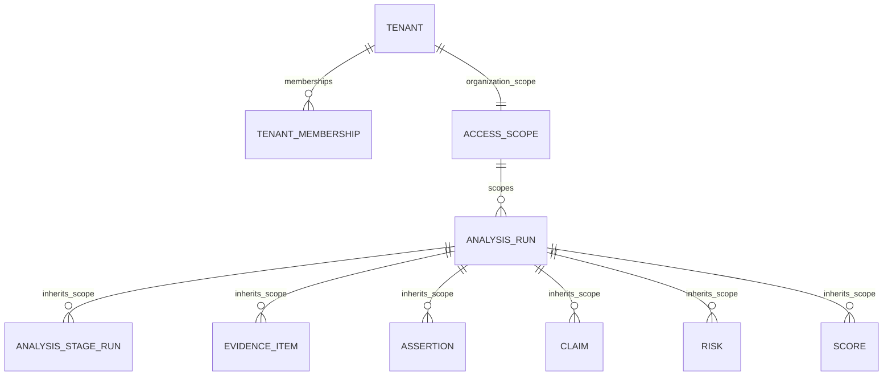

# Logical ERD

**Document:** 10  
**Status:** Complete logical relationship baseline  
**Notation:** Logical entities/cardinalities; not PostgreSQL table DDL.

## 1. Master Intelligence Spine

## 2. Discovery / Identity ERD

## 3. Canonical Composition ERD

## 4. Ontology ERD

## 5. Static / Dynamic Analysis ERD

## 6. Evidence / Decision ERD

## 7. Knowledge / RAG ERD

## 8. Lifecycle / Control ERD

## 9. Universal Lineage Model

`entity_refs` provides a stable cross-domain address for durable objects that need generic links.

Every arrow that represents derivation can be persisted as a `lineage_edges` record.

## 10. Cardinality Rules

- `CanonicalAgent 1:N AgentVersion`.
- `AgentVersion 1:N AnalysisRun`.
- `AnalysisRun 1:N AnalysisStageRun`.
- `AnalysisRun` has `UNIQUE(analysis_run_id, agent_version_id)` and `UNIQUE(analysis_run_id, scope_id)` in the physical model.
- `ValidationRun` references exact baseline, modified and validation AnalysisRuns; baseline/modified run-version pairs are database-enforced composite FKs.
- Analysis-derived records reference exactly one AnalysisRun unless explicitly external/global.
- Evidence may support many assertions; an assertion may have many evidence items.
- Claims may combine many assertions; assertions may contribute to many claims.
- Risks may be supported by many claims; claims may support multiple risks.
- A score is model-version-specific and analysis-run-specific.
- Policy decisions are policy-set-version-specific and analysis-run-specific.
- RAG knowledge objects are derivative projections of authoritative entity references.
- Embeddings are derivative, versioned and rebuildable.
## 11. Tenant / Scope ERD — V2.0.1

`DERIVED_INHERITED_SCOPE` is not a database scope type. It means the child `scope_id` is forced to the authoritative parent/resolved input scope. PLATFORM vs ORGANIZATION is stored in `security.access_scopes`. See Documents 21/21A.
